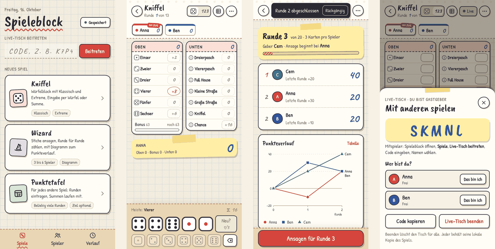

# Spieleblock

Der Block für den Spieleabend: **Kniffel**, **Wizard**, **Hitster** und eine **Punktetafel** für alle anderen Spiele, direkt im Browser. Läuft auf dem eigenen Server, braucht keine Konten und keine App-Installation.



## Was er kann

* **Kniffel** klassisch oder als *Extreme* (17 Felder, Superbonus). Eingabe per Würfel (Augen antippen oder würfeln, jedes Feld zeigt gleich seine Punkte) oder per Summe. Hausregeln für Extra-Kniffel und „Erste Hand“.
* **Wizard** mit Ansagen und Stichen, Geber-Anzeige, Punkteverlauf als Diagramm.
* **Hitster** mit deinen Spotify-Playlists: Songs in den Zeitstrahl einsortieren, Jahre mit MusicBrainz gegengeprüft, Musik über Spotify Connect (braucht eine eigene Spotify-App, siehe [docs/betrieb.md](docs/betrieb.md#hitster-einrichten-spotify)).
* **Punktetafel** für jedes beliebige Spiel: Runden eintragen, Summen laufen mit, optional mit Zielpunktzahl.
* **Live-Tisch:** Alle am Tisch öffnen den Block auf dem eigenen Handy, geben einen Code ein und wählen ihren Namen. Jeder trägt für sich ein, alle sehen den Stand sofort.
* **Spieler, Verlauf, Rekorde:** Mitspieler einmal anlegen, Siege und Bestwerte werden automatisch geführt, ein Diagramm zeigt die Entwicklung über viele Abende.
* **Rückgängig** für jeden Eintrag, Spiele laufen weiter, wenn man den Block schließt.
* **Installierbar und offline-fähig:** Als App auf den Startbildschirm legen; der Block startet auch ohne Netz und gleicht später ab.

Eine Anleitung für Mitspieler steht in **[docs/bedienung.md](docs/bedienung.md)**.

## Wie er gebaut ist

* Ein kleiner **Node-Server** (eine Datei, keine Laufzeit-Pakete, rund 60 MB RAM) speichert die Daten, verteilt Änderungen live und liefert die Web-App aus.
* Die **Web-App** ist in Angular geschrieben.
* Daten liegen als Dateien im Datenordner (Journal, Snapshot, Tagesbackups). Eine Datenbank wird nicht gebraucht.
* **Keine Konten:** Jedes Gerät bekommt eine zufällige Kennung, mit der es seine Spieler und Spiele wiederfindet.

## Aufsetzen

Am schnellsten mit Docker:

```bash
git clone https://github.com/Probastian/spieleblock && cd spieleblock
docker compose up -d --build
```

Dann `http://<Host-IP>:3000` öffnen. Alles Weitere:

| Dokument | Wofür |
|---|---|
| **[docs/deployment.md](docs/deployment.md)** | Installation: Docker, Proxmox, ohne Docker (systemd), Nginx Proxy Manager, Zugriff von außen absichern |
| **[docs/betrieb.md](docs/betrieb.md)** | Einstellungen, Daten und Backups, Updates, Fehlersuche, Datenschutz |
| **[docs/bedienung.md](docs/bedienung.md)** | Anleitung für Mitspieler |
| [docs/architektur.md](docs/architektur.md) | Aufbau des Codes (für Entwickler) |
| [docs/neues-spiel.md](docs/neues-spiel.md) | Ein neues Spiel hinzufügen |

## Entwickeln

Voraussetzung: Node 22.12 oder neuer (empfohlen 24).

```bash
npm install
npm run dev:server      # Server auf :3000
npm run dev             # Angular-Entwicklungsserver auf :4200, leitet /api an :3000 weiter
npm run check           # Typen, alle Tests und Build
```

Das Repo ist ein Monorepo mit den Paketen `shared`, `games`, `server` und `web` unter `packages/`. Details in [docs/architektur.md](docs/architektur.md).
